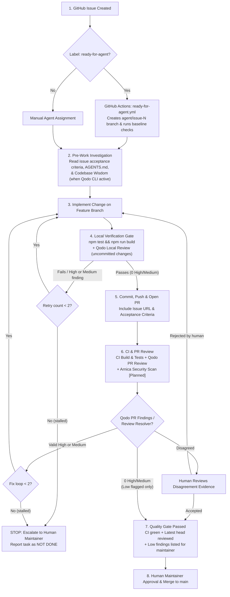

# Hearth Software Factory — Ticket-to-Main Workflow

This diagram documents Hearth's end-to-end delivery pipeline from GitHub Issue creation to merging into `main`, including verification gates, retry limits, and human decision points.

## Gate Summary

| Stage | Check | Blocking Criteria | On Failure / Escalation |
| :--- | :--- | :--- | :--- |
| **Trigger (`ready-for-agent`)** | Baseline `npm test && npm run build` (max 2 attempts) | Non-zero exit code | Stops workflow and comments on issue |
| **Pre-Commit** | `npm test && npm run build` + Qodo local review | Any test/build error or valid High/Medium finding | Fix locally; escalate if stalled after 2 retries |
| **Pull Request** | CI (`node 22`) + Qodo PR review on latest head | Failing CI, stale review, or unresolved High/Medium finding | Fix via Review Resolver loop or escalate with evidence |
| **Merge to `main`** | Human maintainer approval | Unreviewed head, Low findings unreported, or protected path | Maintainer decides whether to merge or request changes |
